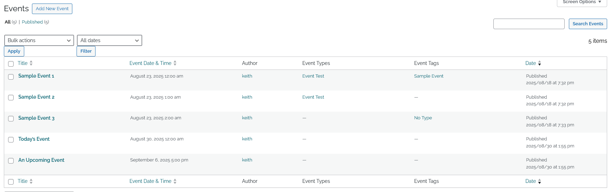
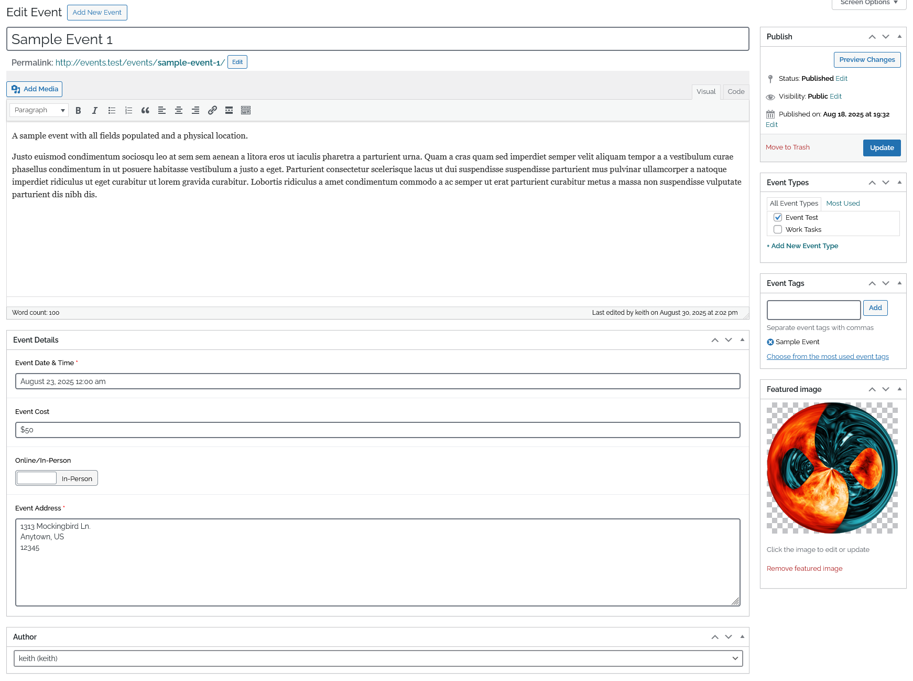
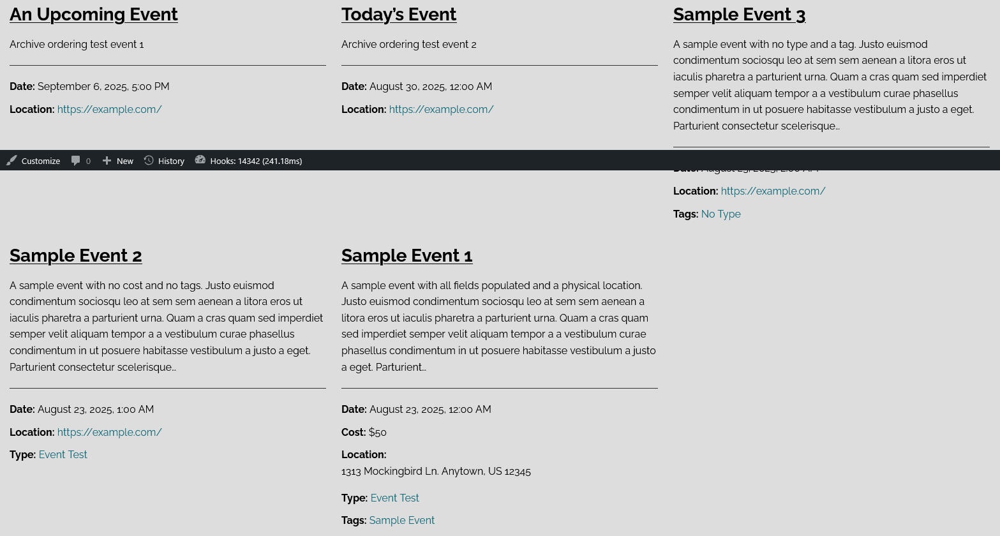
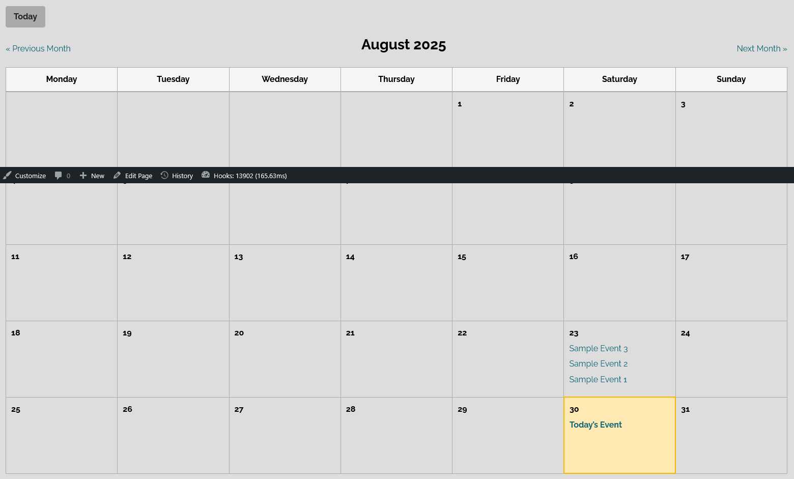

# AA Events

An approachable, theme‑friendly events plugin for WordPress. It adds an `Event` post type, useful taxonomies, ACF‑powered fields, and accessible front‑end templates (archive, single, and a calendar page template). Everything can be overridden from your theme when you need custom markup.

## What you get

- Event post type with archive at `/events`.
- Two taxonomies: `Event Types` (hierarchical) and `Event Tags` (non‑hierarchical).
- Event details via ACF: occurrences, cost, location (online URL vs in‑person address).
- Front‑end templates: archive list, single view, and a calendar page template.
- Theme overrides for templates and styles with simple folder conventions.
- Sensible defaults: the admin date column shows and sorts by the earliest normalized occurrence.

---

## Requirements

- WordPress 5.8+ (uses modern APIs like `wp_date()` and template filters).
- PHP 7.4+.
- Advanced Custom Fields PRO is required for the event fields. **Occurrences** uses the Repeater field, which is an ACF PRO feature. The plugin will load without ACF PRO, but its built-in Event fields and related editing UI will not be available.

---

## Installation

1. Copy the `aa-events` folder into `wp-content/plugins/`.
2. (Required) Install and activate **Advanced Custom Fields PRO** so the Occurrences repeater is available.
3. In WordPress Admin → Plugins, activate “AA Events”.
4. Visit Settings → Permalinks and click Save if your events archive doesn’t appear (activation also flushes rewrites).

---

## Quick Start

1. Create events: Admin → Events → Add New.
2. Fill in the “Event Details” fields:
   - **Occurrences**: Add one row for each occurrence. A start date is required in every row; start time, end date, end time, and All Day are optional.
   - **Event Date & Time** (optional compatibility field only; use Occurrences when creating or editing event dates)
   - Event Cost (optional)
   - Online/In‑Person toggle (optional)
   - Event URL (required when Online)
   - Event Address (required when In‑Person)
   - Contact Email (optional; displayed on the single-event page)
   - Contact Phone Number (optional; displayed as a clickable link on the single-event page)
3. View your list of events at `/events` and single event pages at their permalinks.
4. For a calendar view, create a new Page and choose the "Events Calendar" template, then publish.

### Event Occurrences

The **Occurrences** repeater is the primary schedule editor. Each row describes one continuous occurrence:

1. Click **Add Occurrence** and enter its required Date.
2. Optionally add a Start Time. Add an End Date and/or End Time when the occurrence continues beyond its starting point; leaving the end blank is valid.
3. Enable **All Day** for an all-day occurrence. This hides the time controls, and saved time values are ignored.
4. Add another row when the event occurs again. Rows may freely mix single-day, multi-day, timed, and all-day occurrences; the plugin does not generate recurrence rules.

For example, one event can have a row starting Friday at 6:00 PM and ending Sunday at 2:00 PM, plus a later row with a different date and **All Day** enabled. That is one continuous weekend occurrence followed by one separate all-day occurrence.

**Backward compatibility:** Existing `event_dates` rows continue to work. The plugin also reads the optional legacy **Event Date & Time** (`event_datetime`) value and older standalone `date`/`start_time` fields when no occurrence rows are present. Saving a legacy-only event in the editor creates one equivalent occurrence row. No bulk migration is required, and later saves do not add duplicate rows.

### Recurring Events

Turn any **Occurrences** row into a recurring series by enabling **Repeat** at the bottom of the row. All fields are off by default, so existing events are unaffected.

- **Every / Unit** — Step every N units. Unit is day, week, month, or year. Month and year units anchor on day-of-month, so January 31 + 1 month = February 28 (or 29 in a leap year), not March 3.
- **Ends** — Choose when the series stops:
  - **Never** — open-ended, capped internally at 5 years past the start date or 730 total occurrences, whichever fires first.
  - **On date** — stops on or after the chosen end date.
  - **After count** — stops after the chosen total occurrence count (the parent counts as the first).
- **Weekdays** (Weekly unit only) — Pick one or more weekdays to use as anchors. Leave empty to step weekly from the start date's weekday.
- The original row's start time, end time, and All Day flag carry into every generated occurrence. A multi-day parent produces multi-day children with the same span.
- An occurrence generated from a recurring row is marked `Recurring` on the archive and single-event views.
- Invalid patterns (zero interval, unknown unit, end date earlier than start, etc.) degrade to a single occurrence rather than blocking save.

Recurrence metadata is stored on the row itself. The plugin expands the row on demand inside `aa_events_get_occurrences()`, so the archive, single event page, calendar, and admin sort all see the same expanded list with no extra configuration.

---

## Content Model

- Post type: `event`
  - Public, has archive (`/events`), supports title, editor, author, thumbnail.
- Taxonomies
  - `event_type` (hierarchical, slug `event-type`)
  - `event_tag` (non‑hierarchical, slug `event-tag`)
- Admin UX
  - Adds a “Date & Time” column on Events list, showing the earliest normalized occurrence and a count of additional occurrences; sorting uses the earliest occurrence.

---

## Front‑End Views

- Archive: `/events` uses `templates/archive-event.php`.
- Single: each event uses `templates/single-event.php`.
- Calendar page: Page → Template → “Events Calendar” renders `templates/template-calendar.php` which includes `templates/calendar.php`.
- Calendar navigation: query args `?aa_month=MM&aa_year=YYYY` change the visible month; “Today” jumps back to the current month. (`month`/`year` still work for legacy links.)
- Day cells show up to 3 event entries; when more events fall on the same day, the cell renders a `+N Events` link to a day view for that day.
- Day view: query arg `?aa_day=YYYY-MM-DD` on the calendar page renders all events for that single day with Previous day, Next day, and Back to calendar navigation.
- Archive and single templates show each occurrence as a formatted date or date/time range.
- Single-event pages show a clickable Contact Email when a valid address is provided.
- Single-event pages show a clickable Contact Phone Number when a valid number is provided.
- On desktop and tablet, visitors can switch between Calendar and List views. Calendar is the initial default; the visitor’s selection is saved in the browser and restored after month navigation and on later visits.
- Calendar view uses a traditional month grid. Multi-day occurrences render as bars spanning each week they cross, with the event title repeated on each weekly segment.
- At `640px` wide and below, the view switcher is hidden and the chronological List view is always used, regardless of any saved desktop preference.
- Occurrences that cross into the visible month are included even when they start before it or end after it.
- Calendar dates use the site timezone and the week layout respects Settings → General → “Start of week”.

---

## Theme Overrides

The plugin is designed to be theme‑override friendly. Copy any template into your theme under `your-theme/aa-events/` and it will be used instead of the plugin version.

- Templates you can override:
  - `archive-event.php`
  - `single-event.php`
  - `template-calendar.php` (page template)
  - `calendar.php`

Example: to override the archive, create `your-theme/aa-events/archive-event.php`.

Page template in a theme: the “Events Calendar” page template also respects theme overrides at `your-theme/aa-events/template-calendar.php`.

An existing `your-theme/aa-events/calendar.php` remains authoritative. It does not automatically acquire the plugin template’s week-spanning bars, List markup, or desktop switcher. Theme authors can update overrides using `aa_events_get_occurrences()`, `aa_events_format_occurrence()`, and `aa_events_occurrence_time_markup()`. A CSS override must also cover any calendar, agenda, and switcher markup it adopts.

---

## Styling

- Default CSS ships with the plugin and is enqueued automatically.
- To replace it, add `your-theme/aa-events/aa-events.css`. If present, the theme stylesheet is loaded instead of the plugin’s, even when the theme does not override any templates.
- Existing theme stylesheet overrides must add styles for the calendar utility row, view switcher, selected and focus states, hidden inactive view panel, and the forced List view at `640px` wide and below.
- Default styles target the day-cell overflow link (`.aa-events-calendar-day-more-link`) and the day view (`.aa-events-calendar-day-view`, `.aa-events-calendar-day-nav`, `.aa-events-calendar-day-list`, `.aa-events-calendar-day-item`). Theme overrides that replace `aa-events.css` should provide their own rules for these classes.

Note: The bundled CSS is intentionally minimal. Use the override to match your theme.

---

## Developer Notes

- Occurrence helpers:
  - `aa_events_get_occurrences( $post_id )` returns chronologically sorted, normalized rows from the occurrence repeater or a legacy fallback. Rows include `source`, `start_inferred`, and `end_inferred`; the inference flags identify legacy-derived starts and defaulted ends.
  - `aa_events_format_occurrence( $occurrence )` returns the localized visible range label.
  - `aa_events_occurrence_time_markup( $occurrence )` returns escaped, accessible `<time>` markup for a normalized occurrence.
- Template loader helpers:
  - `events_get_template( $template_name, $args = [], $template_path = 'aa-events/', $default_path = AA_EVENTS_PLUGIN_DIR . 'templates/' )`
  - `events_locate_template( $template_name, $template_path = 'aa-events/', $default_path = AA_EVENTS_PLUGIN_DIR . 'templates/' )`
- Filters/actions:
  - `events_get_template` (filter: final located path)
  - `events_locate_template` (filter: path resolution)
  - `events_before_template_part` / `events_after_template_part` (actions around includes)
- Page template registration (no theme file required):
  - Registered as “Events Calendar” and loads from the plugin when selected.

### Custom ACF Field Groups

When an admin-created ACF field group targets the `event` post type, the plugin skips its built-in field group so the site owner retains control. That custom group must include the new occurrence subfields for the editor to support the current schedule model:

- `event_dates`: Repeater.
- `date`: required Date Picker subfield; return format `Y-m-d`.
- `start_time`: optional Time Picker subfield; return format `H:i:s`.
- `end_date`: optional Date Picker subfield; return format `Y-m-d`.
- `end_time`: optional Time Picker subfield; return format `H:i:s`.
- `all_day`: optional True/False subfield; expected value `1` or `0` (boolean-like).

Use these exact field names. Existing custom groups are not automatically expanded, so their owner must add `end_date`, `end_time`, and `all_day` as well as ensure the repeater and original subfields are present. Normalization, display, and range validation work by field name. The plugin validates any `event_dates` repeater whose subfield names match those above, including custom groups with generated field keys.

---

## Screenshots

**Admin Event List**


**Event Edit**


**Events Archive**


**Calendar Page**


---

## Override Examples

Below are minimal examples showing how to override templates and styles from a theme. Copy into your theme under `your-theme/aa-events/`.

Example: override archive layout at `your-theme/aa-events/archive-event.php`:

```php
<?php
/* Template: Events Archive (Theme Override) */
get_header(); ?>

<div id="primary" class="content-area">
  <main id="main" class="site-main">
  <?php if ( have_posts() ) : ?>
    <header class="page-header"><h1>Events</h1></header>
    <?php while ( have_posts() ) : the_post(); ?>
      <article <?php post_class('aa-event-item'); ?>>
        <h2 class="aa-event-title"><a href="<?php the_permalink(); ?>"><?php the_title(); ?></a></h2>
        <p class="aa-event-when">
          <strong>Date:</strong>
          <?php
          foreach ( aa_events_get_occurrences( get_the_ID() ) as $occurrence ) {
              echo aa_events_occurrence_time_markup( $occurrence ); // Helper returns escaped markup.
              echo '<br>';
          }
          ?>
        </p>
        <div class="aa-event-excerpt"><?php the_excerpt(); ?></div>
      </article>
    <?php endwhile; the_posts_navigation(); ?>
  <?php else : ?>
    <p>No events found.</p>
  <?php endif; ?>
  </main>
 </div>
<?php
get_sidebar();
get_footer();
```

Example: override the single-event content at `your-theme/aa-events/single-event.php`:

```php
<?php get_header(); ?>
<main id="primary" class="site-main">
  <?php while ( have_posts() ) : the_post(); ?>
    <article <?php post_class('aa-event-item'); ?>>
      <h1 class="aa-event-title"><?php the_title(); ?></h1>
      <p class="aa-event-when">
        <strong>Date:</strong>
        <?php
        foreach ( aa_events_get_occurrences( get_the_ID() ) as $occurrence ) {
            echo aa_events_occurrence_time_markup( $occurrence ); // Helper returns escaped markup.
            echo '<br>';
        }
        ?>
      </p>
      <div class="aa-event-content"><?php the_content(); ?></div>
    </article>
  <?php endwhile; ?>
</main>
<?php get_footer(); ?>
```

Example: replace styles by adding `your-theme/aa-events/aa-events.css`:

```css
/* Theme override for AA Events */
.aa-events-calendar-weekday,
.aa-events-calendar-day { border-color: #ddd; }
.aa-events-calendar-day.today-cell { background: #e6f7ff; border-color: #1890ff; }
.aa-events-calendar-event { font-size: 1rem; }
```

---

## FAQ

- The “Events Calendar” template doesn’t show up?
  - Ensure the plugin is active. The template is registered by the plugin and appears in the Page Template dropdown. If you still don’t see it, check the Page sidebar and expand the Template panel.
- Calendar shows no events?
  - Make sure you created published Event posts and added at least one valid **Occurrences** row with a Date. Older events can also appear through the optional legacy **Event Date & Time** (`event_datetime`) or standalone date fallback. The calendar includes occurrences overlapping the selected month and uses the site timezone.
- Can I use only the archive without the calendar?
  - Yes. The archive at `/events` works independently of the calendar page template.

---

## License

GPL-2.0-or-later. See `LICENSE` or the plugin header for details.
